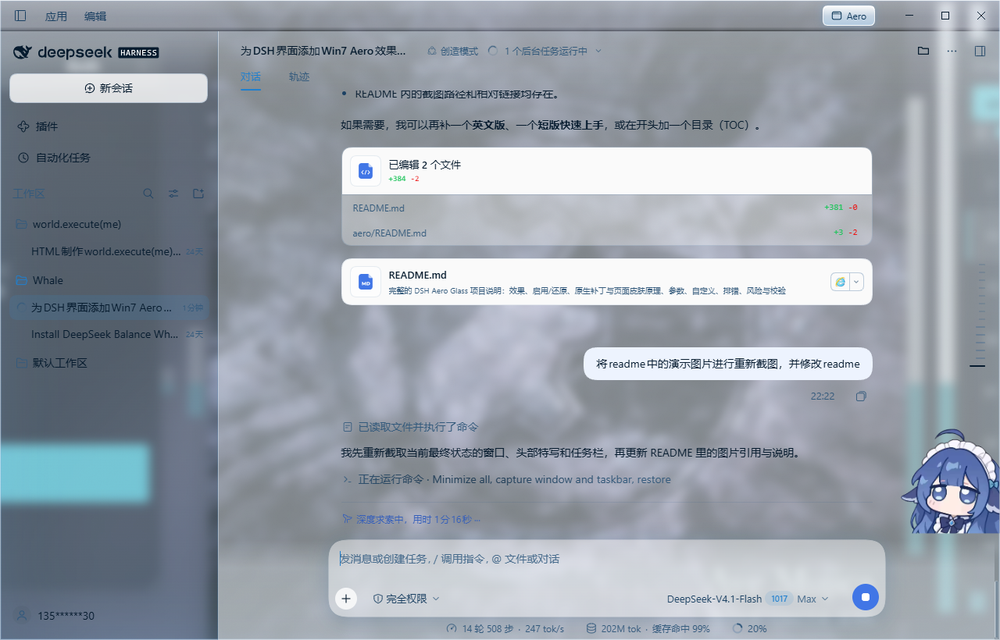
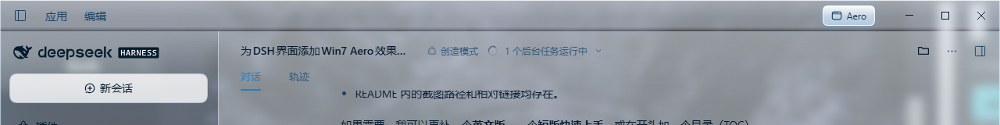
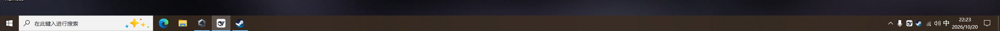

# DSH Aero Glass

A Windows 7 Aero-inspired glass skin for the **DSH Desktop** Web UI, plus an
optional Windows 10 native blur patch that makes the window show the real
desktop behind it.

The project has two independent halves:

| Part | What it does | Install |
| --- | --- | --- |
| **Page skin** (`dsh-aero-skin`) | Glass tokens, translucent panels, titlebar/header/control treatment, settings toggle | DSH plugin market or manual local install |
| **Native patch** (`aero/`, optional) | Transparent Electron window + DWM BlurBehind + taskbar Acrylic | Build locally, copy `app.asar`, restart |

The page skin works on its own (it paints an in-page aurora wallpaper and
simulates the frost). The native patch is what makes the desktop and other
windows actually visible through the glass.







---

## Install the page skin

### From the DSH plugin market

1. Open **Plugins**, click **More** next to **Experimental plugins**, and turn on
   **Custom plugin market**.
2. Open the **Discover** tab, choose **Add index source**, and enter:

   ```text
   https://cdn.jsdelivr.net/gh/haitunlang/dsh-aero-glass@main/market/index.json
   ```

3. Find **Aero Glass Skin**, open it, and install a compatible version.

The market is a self-hosted JSON index (see the
[DSH plugin market guide](https://deepseek-harness.github.io/deepseek-harness/guide/plugin-market)).
The index for this repository points at the `dsh-aero-skin` folder in this
repo at a pinned commit.

### Manual / development install

Install `dsh-aero-skin/` through the DSH plugin manager as a local bundle, or
link it into the profile's `node_modules` the same way DSH installs local
bundles. The package declares `dsh.bundle` and `dsh.client`, so the Host loads
the patch and the Web UI loads `client.js`.

After installing, reload the page or restart DSH. The **Aero** pill appears
in the titlebar and a **Aero glass effect** row appears under Settings →
General. Both share the `dsh-aero:enabled` localStorage key.

> If you already have a local development copy of this skin enabled, disable
> it before installing the market version; two copies would apply the same
> layers twice.

---

## What the skin changes

- ~50 `--dsw-alias-*` tokens get a glass palette for light and dark themes;
- shell frame, sidebar and content surfaces become translucent with a fine
  noise layer;
- the Windows titlebar strip uses the same glass fill as the content, without
  a separate bright band;
- the conversation header is flat: transparent background, no gradient and no
  bottom line;
- header controls are ghosted: the creation-mode chip has no pill fill, the
  folder button uses a `currentColor` folder outline, and the utilities row
  has no wrapper tiles;
- the content column's top-left radius is zero, removing the notch at the
  sidebar/header junction;
- the settings switch and titlebar pill control the whole skin.

The page skin uses class-name anchors from the current DSH build
(`Dc7zOa_header`, `b06ba0_trigger`, `appIcon`, …). A DSH update can change
those names; the skin then falls back to defaults instead of breaking the app.
The selector-based details are intentionally best-effort.

---

## Native Windows 10 blur (optional)

> Advanced and version-specific. Read [`aero/README.md`](aero/README.md)
> before touching `resources/app.asar`.

The native patch is built from **your own** DSH installation; this repository
does **not** ship a patched asar or DSH's `main.js`.

1. Back up `resources/app.asar`.
2. Set `DSH_ROOT` to your DSH install directory (default `D:\DSH`).
3. Run:

   ```powershell
   cd aero
   node extract-main.js
   node patch-main.js
   node repack.js
   ```

4. Close DSH, copy `aero/app.asar.patched` over `resources/app.asar`, and
   start DSH.

The patch is written for DSH 0.2.1-rc.2 and will fail if the main-process
anchors changed. The window uses DWM **BlurBehind** (state 3) rather than
Acrylic because Acrylic doubled the measured drag cost; the taskbar uses
Acrylic (state 4), re-applied every five seconds.

To undo, restore the backup asar. Windows 10 only; DSH updates overwrite the
patched asar.

---

## Repository layout

```text
dsh-aero-skin/        page skin bundle (market package)
aero/                 optional native patch scripts + README
tools/                screenshot / DWM helpers (development)
shots/                README screenshots
LICENSE               MIT
```

The native patch outputs (`main.orig.js`, `main.patched.js`,
`app.asar.patched`) and the DSH source are intentionally ignored by git.

---

## Development

The page skin is a single client bundle in `dsh-aero-skin/client.js`:

- `TOKENS` — the glass token layer;
- `CSS` — scoped `html[data-aero]` styles, native mode and fallback mode;
- `apply()` — theme registration, CSS injection, titlebar pill and settings
  row.

The folder can be linked into a DSH profile for development; changes are
picked up by the Host's client loader (reload the page if necessary).

`tools/` contains the screenshot helper (`ds-shot.ps1`), taskbar material
tester (`taskbar-test.js`), and drag benchmarks. They assume a Windows DSH
install; set `DSH_ROOT` where supported or edit the path at the top.

---

## License

MIT. See [LICENSE](LICENSE).

The MIT license covers the original code and assets in this repository. DSH,
Electron and their dependencies are **not** included and remain under their
respective licenses. The native patch scripts modify a local DSH installation
for interoperability; no DSH source is redistributed here.

Screenshots show the DSH UI and the local desktop wallpaper for demonstration.
